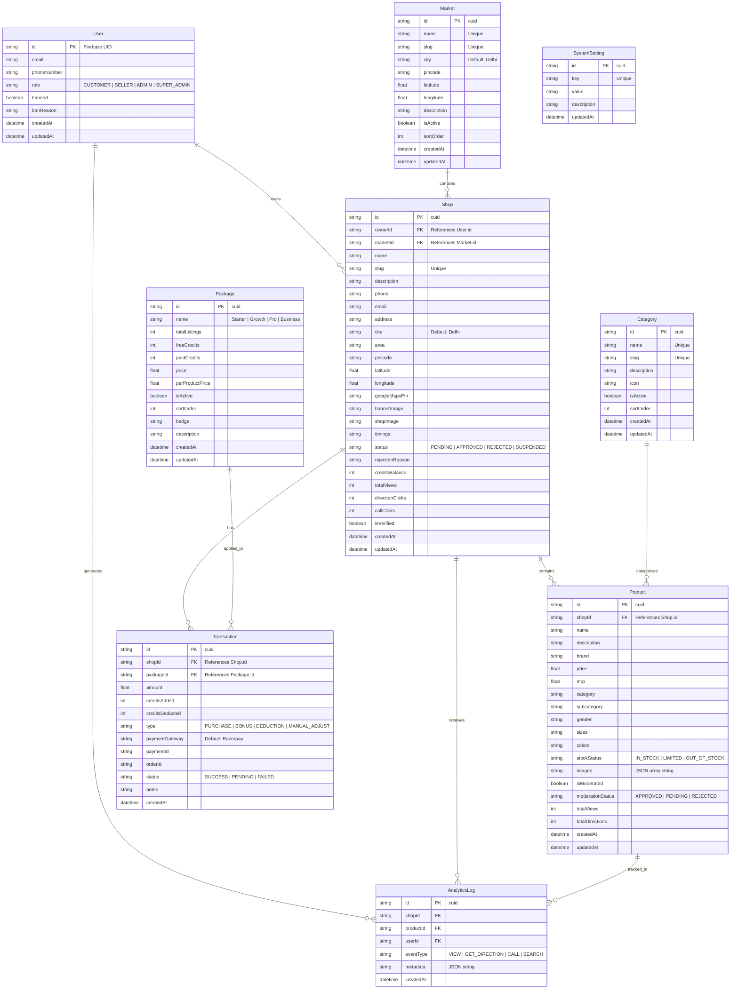
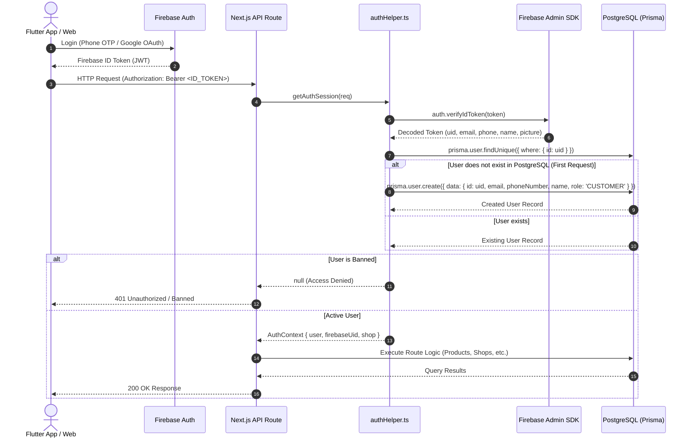

# Backend Architecture, Database Schema & Firebase Sync Flow

This document details the architectural relationship between **Firebase Authentication**, the **Next.js Backend API**, and the **PostgreSQL Database (via Prisma ORM)** in Vyom Shop.

---

## 1. High-Level Architecture

The system splits authentication and state management between Firebase and PostgreSQL:

```
┌───────────────────────────────────────┐
│     Client (Flutter Mobile / Web)     │
└──────────────────┬────────────────────┘
                   │ 1. Sign In (Google / Phone OTP)
                   ▼
┌───────────────────────────────────────┐
│            Firebase Auth              │
│    (Issues JWT ID Token with UID)     │
└──────────────────┬────────────────────┘
                   │ 2. API Request: Header `Authorization: Bearer <ID_TOKEN>`
                   ▼
┌───────────────────────────────────────┐
│       Next.js Backend API             │
│  - Verifies Token via Firebase Admin  │
│  - JIT (Just-In-Time) Sync with DB    │
└──────────────────┬────────────────────┘
                   │ 3. Queries / Updates with Prisma ORM
                   ▼
┌───────────────────────────────────────┐
│        PostgreSQL Database            │
│  - Users, Shops, Products, Wallets    │
└───────────────────────────────────────┘
```

- **Firebase Auth**: Manages credentials, Phone OTP verification, Google OAuth, and secure token issuance.
- **PostgreSQL Database**: Serves as the single source of truth for business data: roles, shop profiles, product listings, credits/wallets, transactions, and analytics.
- **Next.js Backend API**: Validates Firebase ID tokens, dynamically synchronizes user profiles into PostgreSQL, and enforces role-based access control (RBAC).

---

## 2. Database Schema & Entity Relationships

The Prisma schema (`backend/prisma/schema.prisma`) defines 9 core models:



### Schema Design Highlights

1. **`User.id` equals Firebase UID**:
   Rather than auto-generating arbitrary IDs, `User.id` stores the Firebase UID directly. This ensures $O(1)$ lookups without join tables.
2. **Cascade Deletions**:
   Deleting a `User` cascades to their `Shop`s, which in turn cascades to `Product`s and `Transaction`s.
3. **Geospatial Coordinates**:
   `Shop.latitude` and `Shop.longitude` are stored as floating point numbers, used for Haversine distance computations in nearby searches.
4. **Credit-Based Economy**:
   Sellers maintain a `creditsBalance` in their `Shop` record. Adding products or purchasing packages adjusts this balance and appends an immutable `Transaction` record.

---

## 3. Firebase & PostgreSQL Synchronization Flow

Synchronization is handled **Just-In-Time (JIT)** via `getAuthSession(req)` in `backend/src/lib/authHelper.ts`. No webhook or Cloud Function is required.



### Detailed Lifecycle Steps

### Step 1: Client Obtains Firebase ID Token
The client authenticates directly with Firebase using Google Sign-In or Phone OTP:
```dart
// Flutter Example
UserCredential credential = await FirebaseAuth.instance.signInWithCredential(...);
String? idToken = await credential.user?.getIdToken();
```
The client passes this token on every API call:
```http
Authorization: Bearer <idToken>
```

### Step 2: Server-Side Token Verification
When the request reaches the Next.js API, `getAuthSession()` runs:
1. Extracts the Bearer token from the `Authorization` header.
2. Verifies the cryptographic signature and token expiration using the Firebase Admin SDK:
   ```typescript
   const { auth } = getFirebaseAdmin();
   const decodedFirebase = await auth.verifyIdToken(token);
   ```

### Step 3: Just-In-Time (JIT) Database Synchronization
The backend checks if a corresponding record exists in PostgreSQL:
```typescript
let dbUser = await prisma.user.findUnique({
  where: { id: uid },
  include: { shops: { take: 1 } },
});

if (!dbUser) {
  // Auto-provision user upon first authenticated request
  dbUser = await prisma.user.create({
    data: {
      id: uid,              // Uses Firebase UID as primary key
      email: email || null,
      phoneNumber: phoneNumber || null,
      name: name || null,
      image: picture || null,
      role: "CUSTOMER",     // Default role
    },
    include: { shops: { take: 1 } },
  });
}
```

### Step 4: Role-Based Authorization Guard
API routes protect themselves using `requireAuth()`:
```typescript
// Example: Seller-only route
export async function POST(req: NextRequest) {
  const authRes = await requireAuth(req, ["SELLER", "ADMIN", "SUPER_ADMIN"]);
  if ("response" in authRes) return authRes.response; // Returns 401/403

  const { authContext } = authRes;
  const sellerId = authContext.user.id;
  // Route implementation...
}
```

---

## 4. Key Workflows & State Transitions

### A. Role Lifecycle (`CUSTOMER` ↔ `SELLER`)
1. By default, every newly provisioned user starts with role `CUSTOMER`.
2. Users who log in to the Seller Portal remain `CUSTOMER` while setting up their shop application.
3. Upon shop application submission (`POST /api/seller/shop`), a `shops` record is created with `status: "PENDING"`.
4. **Admin Approval**: When an admin approves the shop (`status: "APPROVED"` via `/api/admin/shops/[id]`), the owner's role is automatically upgraded to `SELLER`.
5. **Admin Rejection / Suspension / Deletion**: If the shop is rejected, suspended, or deleted by the admin, the owner's role is reverted back to `CUSTOMER` (provided they have no other approved shop).

### B. Shop Lifecycle
1. **Creation**: User registers shop via `POST /api/seller/shop` (`status: "PENDING"`).
2. **Moderation**: Admin reviews the shop via `/api/admin/shops/[id]`. Approving sets `status: "APPROVED"` and user role to `SELLER`. Rejecting sets `status: "REJECTED"` with a reason and reverts user role to `CUSTOMER`.
3. **Resubmission**: If rejected, the user can edit details (`PUT /api/seller/shop`), which resets status back to `PENDING` for re-review.
4. **Product Publishing**: Once approved, sellers can upload products (`POST /api/seller/products`). Publishing checks and deducts `shops.creditsBalance`.

### C. Credit Packages & Purchases
1. Seller views credit plans via `GET /api/seller/packages`.
2. Seller initiates checkout via `POST /api/seller/wallet/checkout` (Razorpay order generated).
3. Upon payment verification via `POST /api/seller/wallet/verifyPayment`, `shops.creditsBalance` increments and a `transactions` record with status `SUCCESS` is recorded.

### D. Geolocation & Discovery
1. Customers call `GET /api/customer/shops/nearby?lat=28.7041&lng=77.1025&radius=10`.
2. The server filters approved shops and computes distances using the Haversine formula:
   $$d = 2r \arcsin\left(\sqrt{\sin^2\left(\frac{\Delta \phi}{2}\right) + \cos(\phi_1)\cos(\phi_2)\sin^2\left(\frac{\Delta \lambda}{2}\right)}\right)$$
3. Customer interactions (viewing shop, clicking call, requesting directions) trigger `POST /api/customer/analytics/event`, which updates aggregate counters (`totalViews`, `directionClicks`) and logs detailed entries in `analytics_logs`.
